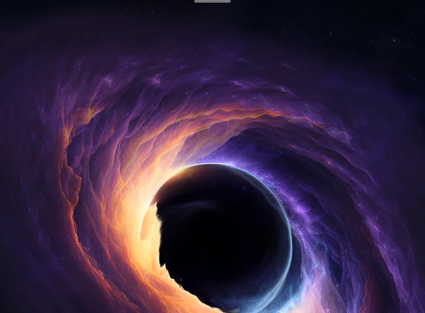
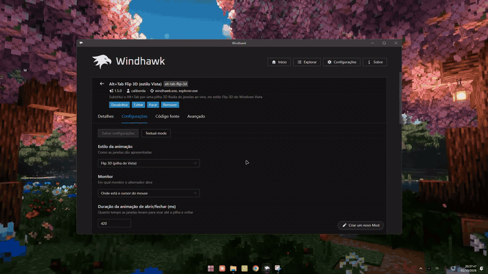

<picture><source media="(prefers-color-scheme: dark)" srcset="assets/idioma/en-dark.svg"></picture>

<picture><source media="(prefers-color-scheme: dark)" srcset="assets/en/hero-dark.svg?v=pa"></picture>

  
  
  
  
  

  

<h3 align="center">22,126 people use my Windhawk mods</h3>

Made in Brazil  · free, open source, and reviewed by Windhawk before every release.

 

### Júlio Caliberda · Product Analyst · Pato Branco, Brazil 

I am a Product Analyst at **Bitz Softwares**: my job is to understand the problem before any line of code. My own projects use the same method. I define what needs to exist, how it should work and when it is done, and AI writes the code.

 

### Windhawk mods

<a href="https://windhawk.net/mods/mac-island-dock"><picture><source media="(prefers-color-scheme: dark)" srcset="assets/en/d-island-dark.svg?v=wh2"></picture></a> 

<a href="https://windhawk.net/mods/alt-tab-flip-3d"><picture><source media="(prefers-color-scheme: dark)" srcset="assets/en/d-windhawk-dark.svg?v=wh"></picture></a> 

The third one, [Windows Terminal Start Minimized](https://windhawk.net/mods/windows-terminal-start-minimized), is a small one: it opens Windows Terminal minimized at sign-in. [All three together on one page](https://github.com/cesarkali/windhawk-mods-showcase).

**The mods are free and will stay free.** If one of them made your Windows nicer and you want to help:

 

Found a bug or have an idea? Open an [issue in the official repo](https://github.com/ramensoftware/windhawk-mods/issues), so nothing gets lost.

 

### Other projects

| Project | What it is |
|---|---|
| **[Financial Kali](https://kali.caliberda.com.br)** | multi-company finance management with an AI assistant, on the web and as a native app |
| **[FlowVoice](https://flowvoice.caliberda.com.br/)** | AI voice dictation into any Windows field, offline if you want · 15 releases · [code](https://github.com/cesarkali/Flow-Voice) |
| **[Semantic Tab Grouper](https://chromewebstore.google.com/detail/semantic-tab-grouper/illkdfiegklhcjogdhplihjekfjdocgk)** | Chrome extension that groups tabs by subject, with the AI running in the browser itself · [code](https://github.com/cesarkali/Semantic-Tab-Grouper) |
| **[PMTT](https://pmtt.caliberda.com.br)** | records the invisible work of people who build products · [code](https://github.com/cesarkali/Product-Manager-Timer-Tracker) |
| **[The Four Temperaments](https://qt.caliberda.com.br/)** | a self-knowledge inventory with 128 questions, all in the browser |
| **[CNPJ API](https://ccnpj.caliberda.com.br/)** | data on any Brazilian company from its tax ID · [code](https://github.com/cesarkali/ccnpj) |

 

### Games and experiments

- **[Kessler Cascade](https://kessler.caliberda.com.br)** · you have no weapons: you catch what is fired at you and throw it back
- **[AFÓTICA](https://afotica.caliberda.com.br)** · sound is your sight, and it gives away where you are
- **[HORIZONTE](https://fable-airplane.vercel.app)** · 3D flight with 26 real Brazilian airports
- **[Neon Strike](https://neonstrike.caliberda.com.br)** · cyberpunk arcade with a soundtrack generated in the browser
- **[CS2 Mix](https://www.caliberda.com.br/cs2mix)** · balanced teams from real Leetify ratings
- **[AllayFriend](https://allayfriend.caliberda.com.br)** · Minecraft mod with an AI companion running inside the game
- **INSONE, Nights Owed** · horror mod for Minecraft with an original story, in progress

### Clients

Sites for creators and local businesses: [Isa Titon](https://isatiton.com.br), [Karol ZK](https://karolzk.com.br) and [Petshop 4i](https://petshop-4i.vercel.app).

 

### The numbers

<picture><source media="(prefers-color-scheme: dark)" srcset="assets/en/numeros-dark.svg?v=wh"></picture>

<picture><source media="(prefers-color-scheme: dark)" srcset="assets/en/heatmap-dark.svg?v=hub"></picture>

 

Get in touch: [julio@caliberda.com.br](mailto:julio@caliberda.com.br) · [LinkedIn](https://linkedin.com/in/hxtdll) · [caliberda.com.br](https://www.caliberda.com.br)

<picture><source media="(prefers-color-scheme: dark)" srcset="assets/idioma/pt-dark.svg"></picture>

<picture><source media="(prefers-color-scheme: dark)" srcset="assets/hero-dark.svg?v=pa"></picture>

  
  
  
  
  

  

<h3 align="center">22.126 pessoas usam os meus mods do Windhawk</h3>

Feitos no Brasil  · gratuitos, de código aberto e revisados pelo Windhawk antes de cada versão.

 

### Júlio Caliberda · Product Analyst · Pato Branco, PR 

Sou Product Analyst na **Bitz Softwares**: meu trabalho é entender o problema antes de qualquer linha de código. Nos meus projetos uso o mesmo método. Eu defino o que precisa existir, como deve funcionar e quando está pronto, e a IA escreve o código.

 

### Mods do Windhawk

<a href="https://windhawk.net/mods/mac-island-dock"><picture><source media="(prefers-color-scheme: dark)" srcset="assets/d-island-dark.svg?v=wh2"></picture></a> 

<a href="https://windhawk.net/mods/alt-tab-flip-3d"><picture><source media="(prefers-color-scheme: dark)" srcset="assets/d-windhawk-dark.svg?v=wh"></picture></a> 

O terceiro, o [Windows Terminal iniciar minimizado](https://windhawk.net/mods/windows-terminal-start-minimized), é um menor: abre o Windows Terminal já minimizado no logon. [Os três juntos, numa página só](https://github.com/cesarkali/windhawk-mods-showcase).

**Os mods são de graça e vão continuar assim.** Se algum deixou o seu Windows melhor e você quiser dar uma força:

 

Achou um bug ou tem uma ideia? Abra uma [issue no repositório oficial](https://github.com/ramensoftware/windhawk-mods/issues), assim nada se perde.

 

### Outros projetos

| Projeto | O que é |
|---|---|
| **[Financial Kali](https://kali.caliberda.com.br)** | gestão financeira multiempresa, com assistente de IA, na web e em app nativo |
| **[FlowVoice](https://flowvoice.caliberda.com.br/)** | ditado por voz com IA em qualquer campo do Windows, offline se quiser · 15 versões publicadas · [código](https://github.com/cesarkali/Flow-Voice) |
| **[Semantic Tab Grouper](https://chromewebstore.google.com/detail/semantic-tab-grouper/illkdfiegklhcjogdhplihjekfjdocgk)** | extensão do Chrome que agrupa abas pelo assunto, com a IA rodando no próprio navegador · [código](https://github.com/cesarkali/Semantic-Tab-Grouper) |
| **[PMTT](https://pmtt.caliberda.com.br)** | registra o trabalho invisível de quem faz produto · [código](https://github.com/cesarkali/Product-Manager-Timer-Tracker) |
| **[Os Quatro Temperamentos](https://qt.caliberda.com.br/)** | inventário de autoconhecimento com 128 perguntas, tudo no navegador |
| **[CNPJ API](https://ccnpj.caliberda.com.br/)** | dados de qualquer empresa brasileira pelo CNPJ · [código](https://github.com/cesarkali/ccnpj) |

 

### Jogos e experimentos

- **[Kessler Cascade](https://kessler.caliberda.com.br)** · você não tem armas: captura o que atiram em você e devolve
- **[AFÓTICA](https://afotica.caliberda.com.br)** · o som é a sua visão, e denuncia onde você está
- **[HORIZONTE](https://fable-airplane.vercel.app)** · voo 3D com 26 aeroportos brasileiros reais
- **[Neon Strike](https://neonstrike.caliberda.com.br)** · arcade cyberpunk com trilha gerada no navegador
- **[CS2 Mix](https://www.caliberda.com.br/cs2mix)** · times equilibrados pelo rating real do Leetify
- **[AllayFriend](https://allayfriend.caliberda.com.br)** · mod de Minecraft com um companheiro de IA rodando dentro do jogo
- **INSONE, Noites Devidas** · mod de terror para Minecraft com narrativa própria, em construção

### Clientes

Sites para quem cria conteúdo e para negócios locais: [Isa Titon](https://isatiton.com.br), [Karol ZK](https://karolzk.com.br) e o [Petshop 4i](https://petshop-4i.vercel.app).

 

### Os números

<picture><source media="(prefers-color-scheme: dark)" srcset="assets/numeros-dark.svg?v=wh"></picture>

<picture><source media="(prefers-color-scheme: dark)" srcset="assets/heatmap-dark.svg?v=hub"></picture>

 

Para conversar: [julio@caliberda.com.br](mailto:julio@caliberda.com.br) · [LinkedIn](https://linkedin.com/in/hxtdll) · [caliberda.com.br](https://www.caliberda.com.br)

